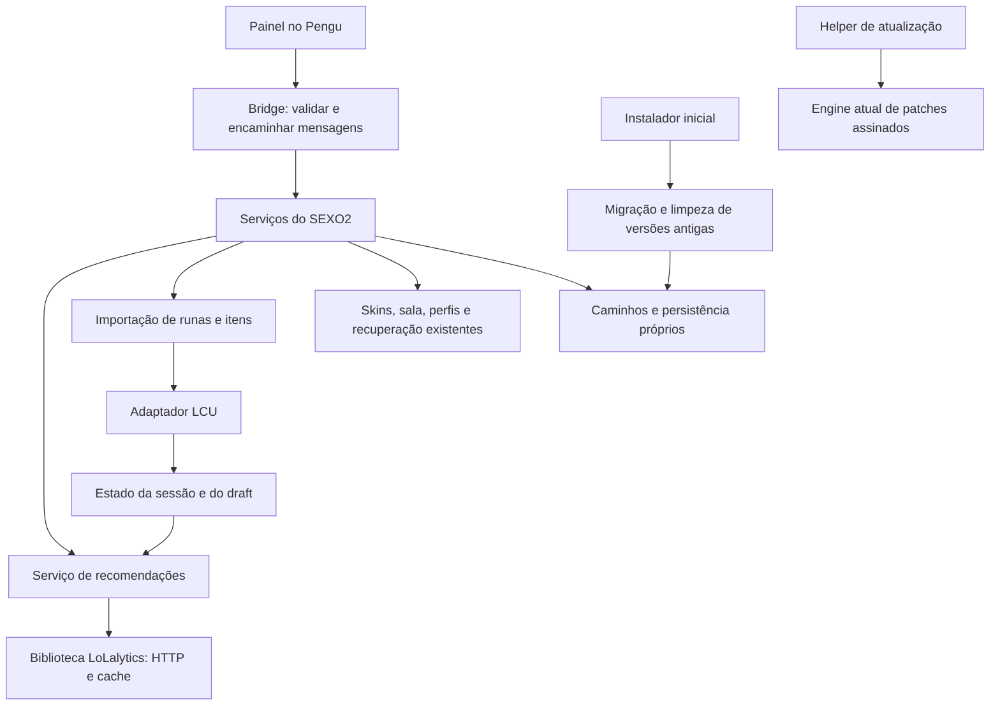

# SEXO2 2.0 — arquitetura e instalação definitiva

Decisão registrada em 16/10/2026. Este é o plano vigente para a versão 2.0;
o código e os instaladores 1.x ainda não implementam a migração descrita aqui.
A publicação inicial da 2.0 depende da conclusão dos critérios deste documento.

## Objetivo

O SEXO2 deve funcionar com identidade, instalação e dados próprios, sem depender
de uma instalação antiga do Rose ou de pastas de teste. Depois da migração
validada, as versões antigas identificadas devem poder ser removidas de verdade.
Não basta trocar o nome do executável ou esconder as pastas.

Preservar as funções atuais de skins, favoritas, perfis, sala, seleção manual,
recuperação e atualização. Integrar as recomendações por etapas, aproveitando
os serviços existentes. Não reescrever componentes estáveis por estética.

## Estado encontrado no checkout

| Evidência | Situação atual | Consequência para 2.0 |
| --- | --- | --- |
| `utils/core/paths.py:get_user_data_dir` | Usa `LocalAppData/Rose`; também usa Rose no fallback XDG | Centralizar os caminhos próprios do SEXO2 |
| `config.py:_reload_config` | Pode copiar `config.ini` do diretório de trabalho | Substituir descoberta implícita por migração explícita e versionada |
| `utils/integration/pengu_loader.py:_resolve_pengu_dir` | Executa a cópia mutável em `get_user_data_dir()/Pengu Loader` | Reposicionar runtime e preservar datastore/plugins particulares |
| `vendor/PenguLoader-1.1.6/loader/Main/RoseConfig.cs` | Aceita `ROSE_CONFIG_PATH`, mas o fallback ainda é `LocalAppData/Rose/config.ini` | Conferir o caminho recebido por todos os componentes nativos |
| `utils/system/admin_utils.py` | Agenda inicialização com tarefa chamada `Rose` | Registrar SEXO2 e retirar a tarefa antiga quando comprovadamente pertencente à instalação migrada |
| `installer-sexo2.iss` | Instala em `LocalAppData/SEXO2`, mas usa o AppId/mutex herdados e preserva dados em Rose | Identidade própria estável e migração dos cadastros antigos |
| `installer-*.iss` históricos | Variantes em `LocalAppData/Rose Teste 0.3`; backups completos `.backup-<data>` | Inventariar instalações e backups; retenção limitada |
| `sexo2/update/` e `updater_main.py` | Atualizador próprio com assinatura, journal e rollback | Reutilizar; separar atualização normal da migração inicial |
| `launcher/update/` | Implementação herdada também permanece no código | Consolidar o caminho de atualização; não manter atualizadores concorrentes |

Os instaladores históricos consultados compartilham o AppId
`B876AA51-DB38-448E-BD13-716F1C9DE750` e o mutex `Local\RoseSingleInstance`.
Um cadastro pode ter substituído o de outra variante: o Registro sozinho não
é um inventário suficiente de todas as cópias antigas.

**Relato do usuário, ainda sem inventário local:** pastas `Rose` e `Rose Teste 3`
em Roaming. Em Windows, `%APPDATA%` normalmente já representa Roaming; os
candidatos são `%APPDATA%\Rose` e `%APPDATA%\Rose Teste 3`. O checkout confirma
dependências em **Local**, mas não comprova a origem/conteúdo dessas pastas em
**Roaming**. Não presumir que `Rose Teste 3` e `Rose Teste 0.3` são a mesma pasta.
Esta rodada ocorreu no checkout Linux, sem acesso ao inventário do PC Windows.

## Arquitetura de destino

Aplicativo local, com serviços e adaptadores; sem adicionar microserviços ou
outro servidor HTTP para organizar o código.



| Responsabilidade | Aproveitar / evolução |
| --- | --- |
| Composição e encerramento | `main/` cria serviços, workers e recursos; encerra-os com ordem definida. Reduzir regras de negócio no bootstrap por etapas |
| UI e bridge | Plugins e `pengu/communication/` apresentam estados e encaminham ações; não fazem scraping, escolhem pastas ou alteram Registro |
| Caminhos e persistência | Política única de programa/dados/runtime/cache, compartilhada entre Python, instalador e componentes nativos |
| Skins e sala | Reutilizar os mecanismos de injeção/recuperação e `friends/`; extrair serviços apenas onde o acoplamento atrapalhar mudanças |
| Recomendações | Usar `sexo2/services/lolalytics.py` e `lolalytics/`; adicionar orquestração de sessão, alvo e risco fora do coletor |
| Importação | Adaptador separado para contratos do cliente LoL, limites de páginas, substituição e confirmação de resultado |
| Instalação/migração | Novo `sexo2/install/`, com planejamento testável e adaptadores Windows; instalador é uma interface fina para esse módulo |
| Atualizações | `sexo2/update/` mantém assinatura, integridade e recuperação; não apaga instalações antigas durante cada atualização |

Na orquestração futura, cada consulta recebe uma revisão do contexto de sessão:
campeão, modo, rota, patch/filtros, alvo e risco. Respostas de contexto antigo são
descartadas, mesmo se o pedido HTTP já estiver em execução. Alterar o alvo não
importa automaticamente dados atrasados. O fim do draft libera a sugestão de
matchup; a escolha do adversário e mudanças antes da partida continuam explícitas.

Manter WR/Common e sugestões por alvo com suas fontes e escopos. Risco é uma
política local, não WR prevista. Reutilizar `plan_item_pages` para o orçamento
real de páginas descoberto pelo importador, preservando páginas pessoais e
separando blocos por contexto. Não inventar uma sequência conjunta de seis itens.

## Instalação e caminhos próprios

| Finalidade | Destino Windows da 2.0 |
| --- | --- |
| Programa e helper assinados | `%LOCALAPPDATA%\Programs\SEXO2` |
| Dados do usuário | `%LOCALAPPDATA%\SEXO2\data` |
| Runtime mutável do Pengu | `%LOCALAPPDATA%\SEXO2\runtime` |
| Cache e logs limitados | `%LOCALAPPDATA%\SEXO2\cache` e `logs` |
| Estado e recibos de migração | `%LOCALAPPDATA%\SEXO2\state` |

O caminho físico deve vir das Known Folders do usuário/sessão corretos, inclusive
quando houver elevação por outra conta. Não escolher o primeiro `explorer.exe`
entre sessões nem construir cegamente `C:\Users\<nome>`. Outros sistemas devem
usar raízes SEXO2 equivalentes, isoladas do perfil de desenvolvimento/testes.

**Colisão a tratar:** o instalador atual já pode ter colocado os binários em
`%LOCALAPPDATA%\SEXO2`. Antes de usar essa raiz para dados/runtime, a migração
precisa inventariar e retirar a instalação antiga para staging controlado,
fora das raízes de destino, com journal recuperável. Nunca apagar essa raiz
inteira depois que ela contiver os dados novos, nem limpar por nome apenas.

Um novo AppId próprio e estável deve identificar a 2.0, com um único cadastro de
instalação. Retirar cadastros anteriores exige validar sua propriedade. Preservar
compatibilidade de transição sem permitir duas instâncias controlarem os mesmos
recursos. Identidade de produto não exige remover créditos e licenças da base.

Mudar apenas `get_user_data_dir` **não conclui** essa tarefa. Auditar config,
datastore, caminhos de plugins, loaders, bibliotecas nativas distribuídas,
autostart e updater. Nenhum componente pode recriar Rose como fallback silencioso
depois da migração. A leitura de `core.dll` e os binários efetivamente empacotados
precisam de validação: comentários/código Python não comprovam comportamento nativo.

## Módulo de migração e limpeza do novo instalador

A limpeza faz parte do instalador inicial da 2.0, não de uma tela permanente no
programa. Usar o fluxo convencional de instalação: resumo objetivo, progresso,
conclusão ou erro com a pendência concreta. Sem dashboard de manutenção, botões
flutuantes, cartões de “otimização” ou aparência de assistente de IA.

Continuar a instalação confirma as mudanças descritas no resumo normal. O padrão
preserva dados úteis compatíveis no destino novo. Se houver opção de instalação
sem importar dados, ela deve ser uma opção convencional e informar a perda antes
da execução. Não transformar essa escolha numa sequência de diálogos redundantes.

### Inventário e propriedade

Procurar candidatos nas raízes conhecidas Local/Roaming, cadastros de instalação,
atalhos, tarefas e locais de instalações anteriores. Incluir as variantes
relatadas, `Rose dos Amigos`, `Rose Sala`, os instaladores de teste conhecidos,
backups e runtimes identificados. Nomes são candidatos, não autorização de apagar.
Pastas personalizadas e arquivos de instalação/ZIPs históricos exigem evidência
de origem; locais extras podem ser informados no instalador, sem varrer discos
inteiros ou todos os perfis por padrão.

Correlacionar executável, destino registrado, manifesto/identidade da versão e
referências dos atalhos/tarefas. Registrar dúvida quando a propriedade não for
comprovada. Uma instalação independente de Rose/Pengu não pertence automaticamente
ao SEXO2. Não executar um desinstalador encontrado só porque tem o nome esperado.

Inventariar e tratar, quando próprios:

- Diretórios antigos de programa, dados, caches, logs, runtimes e backups.
- Entradas de desinstalação nas visões/hives pertinentes, sem apagar outras
  configurações da chave nem supor que HKCU/HKLM sejam equivalentes.
- Atalhos do menu Iniciar/área de trabalho e inicialização automática.
- Tarefa agendada `Rose` e outras variantes comprovadas, verificando a ação/alvo.
- Registro IFEO de `LeagueClientUx.exe`: remover ou trocar somente o valor
  `Debugger` que aponte para o loader da instalação migrada, sem excluir a chave
  inteira ou interferir em um Pengu externo. Conferir também DLL carregada/arquivos
  em uso; a migração não pode deixar um hook apontando para arquivo apagado.

“Limpar de verdade” significa retirar instalações e resíduos administrados pelo
aplicativo e verificar que não voltam. Não significa apagar qualquer ocorrência
da palavra Rose, arquivos do LoL/Riot ou histórico global do Windows, restauração,
antivírus e backups independentes que o instalador não administra.

### Contratos previstos

```text
discover_legacy(context) -> Inventory
plan_migration(inventory, layout, preservation_policy) -> MigrationPlan
execute_migration(plan, journal) -> MigrationResult
verify_migration(plan) -> VerificationResult
```

`context` identifica usuário/sessão e raízes permitidas. Cada candidato contém
origem, evidência de propriedade e situação. O plano contém caminhos resolvidos,
operações, dependências, bytes/espaço e motivo de cada remoção. Resultados usam
estados distintos: concluído, pendente, bloqueado, falhou. Inventário é leitura;
planejamento é testável sem Windows; somente o executor altera o sistema.

### Sequência de execução

1. Inventariar, resolver conflitos e conferir espaço, permissões e arquivos em uso.
   Não encerrar processos só pelo nome nem fechar o LoL à força. Se uma etapa
   exigir descarregar o cliente, comunicar isso antes da alteração correspondente.
2. Preparar journal e staging fora de fontes/destinos em conflito. Recusar links,
   junctions, raízes do sistema e mudanças de propriedade/caminho entre plano e uso.
3. Instalar os binários novos e transferir os dados selecionados com verificação.
   Migrar preferências/perfis/favoritas/skins particulares por schema; não copiar
   INIs cegamente, caminhos de loaders antigos ou credenciais transitórias do LCU.
   Tratar conflitos entre variantes; plugins particulares exigem compatibilidade
   antes de ativação. Não embutir dados pessoais no instalador.
4. Vincular configurações, runtime, hooks e autostart aos destinos novos. Elevar
   apenas as operações que exigirem privilégio; recusa/permissão insuficiente
   deve deixar uma pendência explícita, não uma falsa confirmação de limpeza.
5. Validar o SEXO2 usando apenas suas raízes novas, sem depender das origens.
6. Remover os resíduos antigos cuja propriedade foi confirmada, incluindo os
   cadastros e backups previstos no plano. Não usar `Rose*` como regra de exclusão.
7. Verificar fontes, registros e referências novamente; registrar qualquer resíduo
   ou falha. Não anunciar “limpeza concluída” com uma remoção ainda pendente.
8. Concluir o journal. Manter no máximo uma recuperação transitória identificada;
   removê-la após a validação prevista, sem acumular cópias históricas. Guardar
   apenas um recibo pequeno em `state`, sem conteúdos pessoais ou segredos.

A execução deve ser idempotente e retomável. Antes do commit da migração, falhas
preservam/restauram o estado necessário para recuperar o aplicativo. Após remover
uma origem, a nova cópia dos dados já deve estar validada. A desinstalação da 2.0
também deve retirar registros/runtime próprios; remoção dos dados novos deve ser
uma escolha explícita. O updater cotidiano conserva a recuperação de patch já
existente e não repete a limpeza completa a cada versão.

## Ordem das próximas entregas e critérios de publicação

Por orientação posterior do usuário, instalação própria e limpeza ficam na fase
final. O desenvolvimento funcional segue [DESENVOLVIMENTO_2_0.md](DESENVOLVIMENTO_2_0.md).

1. **Orquestração de sessão/recomendações:** contexto versionado, alvo explícito,
   risco salvo, cache, limites e descarte de respostas atrasadas.
2. **Importação e UI:** contratos reais do LCU, orçamento de páginas, escolhas
   substituíveis e apresentação nativa no painel; sem alterar skins por acidente.
3. **Validação funcional em Windows:** fluxo real de seleção, importação e
   regressões das funções existentes, antes de apresentar o programa como pronto.
4. **Fase final — caminhos e migração/instalador:** layout central e configuração
   nativa, inventário/plano, executor e integração ao instalador. Preservar também
   `sexo2-loadouts.json`, que identifica as páginas gerenciadas no cliente.
   Testar perfis/sessões, elevação e a colisão com a instalação 1.x. Reutilizar as
   garantias do updater sem confundir rollback de patch com migração de Registro.
5. **Publicação:** cumprir os critérios abaixo para a versão inicial definitiva.

- Instalação limpa funciona em usuário sem nenhuma pasta Rose preexistente.
- Migração cobre Local/Roaming e variantes comprovadas, inclusive as relatadas
  pelo usuário após inventário no PC; nenhum nome é tratado como equivalência cega.
- Favoritas, perfis, skins e opções preservadas continuam utilizáveis no destino.
- Origens removidas não são recriadas ao abrir, usar, atualizar e reiniciar o PC.
- Atalhos, tarefa de inicialização, cadastro e hook apontam somente para os
  destinos atuais; nada externo foi removido por associação de nome.
- Testes isolados cobrem falha/interrupção e retomada em cada fase, falta de
  espaço/permissão, arquivos bloqueados, junctions e troca de caminho após o plano.
- Testar em Windows descartável as variantes reais de instalador, usuário com
  acentos, elevação por outra conta e perfis distintos. Mocks não comprovam isso.
- Atualizar e desinstalar não acumula novas instalações, atalhos ou backups.
- Fluxo normal do programa e funções atuais passam pelas regressões pertinentes;
  o usuário confirma a experiência no cliente real antes da publicação.

## Escopo da rodada de arquitetura

Auditoria do checkout, arquitetura de destino e requisitos de release registrados.
Não houve exclusão, consulta ao Registro do PC, mudança de caminhos em runtime,
implementação do executor, compilação de instalador, alteração da versão ou release.
A execução funcional posterior está registrada em
[DESENVOLVIMENTO_2_0.md](DESENVOLVIMENTO_2_0.md). Nenhuma remoção foi habilitada.
